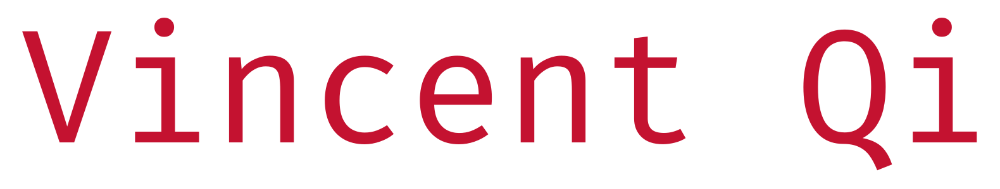

<p align="center">
  <a href="https://www.github.com/vincor-qc"></a>
</p>

<p align="center">
  
</p>

<p align="center">
  &#8287;&#8287;&#8287;&#8287;&#8287;&#8287;&#8287;&#8287;&#8287;&#8287;&#8287;&#8287;&#8287;&#8287;&#8287;&#8287;&#8287;&#8287;&#8287;&#8287;&#8287;
  <a href="https://www.instagram.com/vincent_.qi/"></a>
  &#8287;&#8287;&#8287;&#8287;&#8287;
  <a href="https://www.linkedin.com/in/vincent-qi/"></a>
  &#8287;&#8287;&#8287;&#8287;&#8287;
  <a href="mailto:vincent.qi.2006@gmail.com"></a>
  
</p>

<p align="center">
  
</p>

Hi, I'm Vincent, a CS student at Carnegie Mellon University.

This summer, I worked at **OpenAI** on the integrity foundations team.

Previously, I also worked as a software engineer at **Mercor**, where I built RL envs & frontier evals.

I also started **EduBeyond**, where I developed AI Learning Management Systems. 

Feel free to reach out, I'm always open to meeting new people :)

<br/>
  
<!--START_SECTION:waka-->

```ocaml
From: 04 June 2023 - To: 30 October 2026

Total Time: 344 hrs 16 mins

OCaml            154 hrs 18 mins       ██████████▒░░░░░░░░░░░░░░   40.84 %
Python           138 hrs 23 mins       █████████░░░░░░░░░░░░░░░░   36.63 %
Other            33 hrs 35 mins        ██▒░░░░░░░░░░░░░░░░░░░░░░   08.89 %
Markdown         9 hrs 38 mins         ▓░░░░░░░░░░░░░░░░░░░░░░░░   02.55 %
TeX              6 hrs 51 mins         ▒░░░░░░░░░░░░░░░░░░░░░░░░   01.81 %
JavaScript       6 hrs 50 mins         ▒░░░░░░░░░░░░░░░░░░░░░░░░   01.81 %
```

<!--END_SECTION:waka-->


